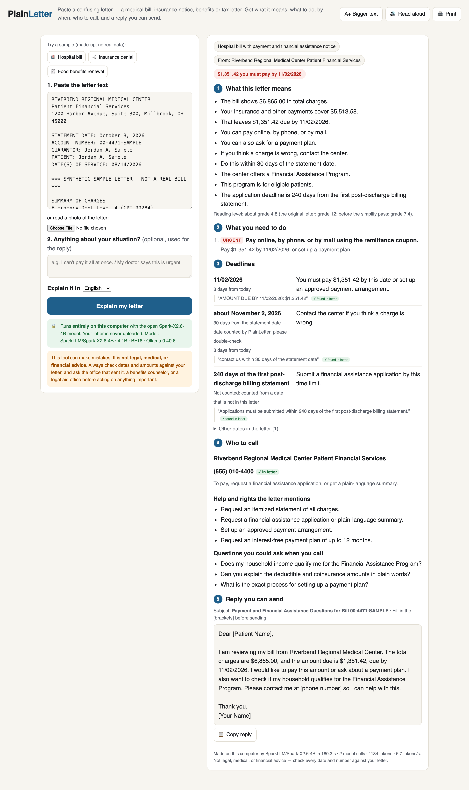

# PlainLetter

**Paste a confusing official letter. Get what it means, what to do, by when, who to call, and a reply you can send. Runs fully offline on your own computer with [Spark-X2.6-4B](https://huggingface.co/XHToken/Spark-X2.6-4B).**

Built for **HER Hack-Astron #7 (Spark-X2.6 Open Source AI for Good)**. Tracks: **Health and well-being** and **Accessibility**.

> ⚠️ PlainLetter is a reading aid, not legal, medical, or financial advice. It can make mistakes. Check every date, amount, and phone number against the original letter, and ask the office that sent it, a benefits counselor, a patient advocate, or legal aid before acting on real claims. All sample letters in this repo are synthetic; no real person's data is used.



## Who this helps

Medical bills, insurance Explanation-of-Benefits and denial notices, food/health benefit renewals, and tax or agency letters are written at a college reading level (the three sample letters here score grade 12.0–12.8 Flesch-Kincaid). The people who most need to act on them often can't read them easily: older adults, people with limited literacy or English, people with cognitive or visual disabilities, and anyone who is sick and stressed. Missing one line ("must be received within 180 days", "a missed interview may result in denial") can cost someone their coverage, their food benefits, or send a bill to collections.

These letters are also full of private health and financial details. People should not have to paste them into a cloud chatbot. PlainLetter runs a 4B open model locally, so the letter never leaves the machine.

## What it does

For each letter, PlainLetter shows:

1. **What this letter means**: 3–8 short sentences at about a 6th-grade reading level (measured, see below).
2. **What you need to do**: steps, most urgent first.
3. **Deadlines**: each with an exact quote from the letter as proof. Rules like "within 180 days of this notice" are turned into a calendar date from the letter's own date, and dates that may already have passed are flagged.
4. **Who to call**: one row per phone number, with the reason to call.
5. **A short reply / appeal draft** with `[brackets]` for what only the reader can fill in. An optional "your situation" box tailors it.

Plus: help and rights the letter mentions, good questions to ask when you call, answers in English / Spanish / Simplified Chinese, a **Read aloud** button (browser speech, offline on macOS), **Bigger text**, print, copy-reply, and offline **photo-to-text** (Tesseract) for a photographed letter.

## How Spark-X2.6-4B is used

Spark-X2.6-4B does all of the language work. There is no other model and no cloud service.

| Step | Who | What |
|---|---|---|
| 1. Explain | **Spark-X2.6-4B** | Reads the letter and returns one JSON object (Ollama structured output with a JSON schema): letter type, sender, money, summary, actions, deadlines (+ exact quotes), contacts, rights, questions, reply subject and draft. |
| 2. Simplify | **Spark-X2.6-4B** | A second short call rewrites only the summary for a 6th-grade reader (≤12 words per sentence). If the rewrite introduces a number not in the letter or the first draft, PlainLetter keeps the first draft. |
| 3. Check | PlainLetter (deterministic Python, no model) | Verifies each deadline quote appears word-for-word in the letter; verifies each phone number's digits appear in the letter; finds every explicit date by regex and lists ones the model did not use; computes calendar dates for "within N days of this notice" rules from the letter date (skipping rules counted from some other date, like "first statement" or "notice of action"); flags past dates; computes Flesch-Kincaid grade of the summary and of the letter. These checks are shown in the UI as ✓ / ⚠ badges. |

The prompts are in [`plainletter/core.py`](plainletter/core.py) (`SYSTEM_PROMPT`, `USER_TEMPLATE`, `SCHEMA`, `SIMPLIFY_PROMPT`) and are also saved in [`outputs/run-metadata.json`](outputs/run-metadata.json).

## Model and environment (as run for the saved outputs)

| | |
|---|---|
| Model | `SparkLLM/Spark-X2.6-4B` via Ollama (`ollama pull SparkLLM/Spark-X2.6-4B`), Ollama digest `44ca4d700630e9a402cb439007132da135b2ca5329985b7f8944d04b7d59f43a` (8,229,921,143 bytes) |
| Upstream weights | Hugging Face `XHToken/Spark-X2.6-4B`, revision `66e3ae7bee54e0a523d692cb8ef841f35409807b` (HEAD of `main` on 2026-10-25; the Ollama build is the one linked from that model card) |
| `ollama show` | architecture `spark2_5`, 4.1B parameters, context length 1,048,576, **BF16** (no quantization), capabilities: tools, thinking, completion |
| Runtime | Ollama 0.40.6, Python 3.11.1 (standard library only), macOS 27.0.1 |
| Hardware | Apple M1, 16 GB unified memory (MacBook) |
| Inference settings | `temperature 0.2`, `top_p 0.95`, `top_k 0`, `seed 7`, `num_ctx 8192`, `num_predict 2048`, `think: false` (thinking level "none"), `format: <JSON schema>`, `stream: false` |
| Speed observed | 6.6–6.8 output tokens/s; 179–248 s per letter (2 model calls) on the M1 |

Why these settings: extraction should be stable, so temperature is low and the seed fixed (the model card's sampling defaults, temperature 1.0, are meant for open-ended chat). Thinking is off to keep a laptop answer under ~4 minutes; `PLAINLETTER_THINK=1` turns it on.

## Setup and run

Requirements: macOS / Linux / Windows with ~10 GB free RAM for BF16, Python 3.10+, [Ollama](https://ollama.com/download) **v0.34.1 or later**. Optional: `tesseract` for photos (`brew install tesseract`).

```bash
ollama pull SparkLLM/Spark-X2.6-4B      # ~8.2 GB, BF16
ollama serve                             # if not already running

cd plainletter
python3 -m plainletter info              # shows model, precision, digest
python3 -m plainletter serve             # web app on http://127.0.0.1:8765
```

Command line:

```bash
python3 -m plainletter samples/02-insurance-denial.txt
python3 -m plainletter samples/03-benefits-renewal.txt --lang es --md out.md --json out.json
python3 -m plainletter photo-of-letter.jpg --note "I can't pay it all at once"
cat letter.txt | python3 -m plainletter -
```

Reproduce the saved outputs:

```bash
python3 scripts/run_samples.py            # writes outputs/*.json, *.md, run-metadata.json
python3 scripts/run_samples.py --lang es --only 03
```

Environment variables: `OLLAMA_HOST` (default `http://127.0.0.1:11434`), `PLAINLETTER_MODEL` (default `SparkLLM/Spark-X2.6-4B`), `PLAINLETTER_THINK` (default off). The web server only binds to `127.0.0.1` and does not log letter text.

## Results (3 synthetic letters, one run each)

Real outputs from Spark-X2.6-4B are in [`outputs/`](outputs/) (`*.md` readable report, `*.json` full answer + checks + timings + the model's raw JSON). Earlier prompt iterations are kept in [`outputs/iterations/`](outputs/iterations/).

| Sample | Letter grade | Summary grade (1st draft → simplified) | Deadlines found / quotes verified | Phones verified | Time |
|---|---|---|---|---|---|
| [01 Hospital bill](samples/01-hospital-bill.txt) | 12.0 | 7.4 → **4.8** | 3 / 3 | 1 / 1 | 179 s |
| [02 Insurance denial](samples/02-insurance-denial.txt) | 12.0 | 11.7 → **6.5** | 2 / 2 | 4 / 4 | 189 s |
| [03 Food benefits renewal](samples/03-benefits-renewal.txt) | 12.8 | 9.9 → **4.2** | 5 / 5 | 3 / 3 | 248 s |

**How this was evaluated:** the numbers above come from PlainLetter's own deterministic checks (verbatim quote match, phone-digit match, Flesch-Kincaid). Each output was also read line by line against its letter (by the AI coding agent that built the project; findings below). Three letters and one run each is a demo, not a benchmark: it shows the workflow works, not how often it fails on real-world letters.

**Reproducibility check:** re-running sample 02 later through the CLI (`python3 -m plainletter samples/02-insurance-denial.txt`, same seed and settings, same machine) produced a byte-identical raw model answer and identical simplified summary (1,202 output tokens, 189 s).

**Code review and re-check:** an independent AI code review (OpenAI Codex) found 8 bugs in the first version of the deterministic checks, CLI and server, e.g. a computed deadline could trust the model's paraphrased rule over the letter's quote, "30 days of *receipt*" was counted from the letter date, and `python -m plainletter letter.txt` failed to parse. All 8 were fixed (deadlines are now computed only from the verified quote, an explicit date must appear inside its quote, the simplify step must keep every number). The checks were then re-applied to the same saved model answers with `scripts/recheck.py`; this changed no deadline in the three samples and added "not counted" notes to the rules counted from other dates.

**Prompt iteration (same 3 letters):** v1 summaries were long copies of the letter (grade 9–10, 1,689 tokens, 273 s for the bill). v2/v3 added brevity rules and a style example (grade 9.3–11.7) but the bill once returned *no actions*. v4 (final) adds `minItems` in the schema and the second "simplify" call (grade 4.2–6.5).

### What it got right

- Every deadline quote and every phone number in all three outputs was found in the source letter (0 invented numbers).
- All explicit due dates were found (11/02/2026; 11/10, 11/18, 11/30, 12/01/2026).
- Relative deadlines were computed correctly: appeal "within 180 calendar days" of Sept 29, 2026 → March 28, 2027; peer-to-peer "within 14 calendar days" → Oct 13, 2026, flagged as possibly passed; itemized-bill dispute "within 30 days of the statement date" → Nov 2, 2026.
- Rules counted from a date not in the letter (FAP "240 days of the first post-discharge statement", fair hearing "90 days of the notice of action") were correctly *not* turned into a date.
- The denial reply draft leaves `[number of weeks of conservative therapy]` for the reader instead of making it up, which matches the actual denial reason.

### Failure cases and limitations seen in these outputs

- **Wrong actor (denial letter):** the first action says *you* call for a "peer-to-peer discussion", but the letter says *your provider* may request it. The step and its "how" text also got mixed with the expedited-appeal number.
- **Imprecise reason (denial letter):** "They did not have your required therapy and red-flag records" — the letter actually says only ~3 of the required 6 weeks of therapy were documented.
- **Muddled wording (benefits letter):** "If you miss the call, contact your worker before 11/18/2026" should be "If you can't make the call…". "You must finish recertification by 11/10/2026" — 11/10 is the form deadline; the period ends 11/30.
- **Too few actions (hospital bill):** only "pay or set up a plan" is listed as an action; "apply for financial assistance" and "ask for an itemized bill" appear only under rights.
- **Reply drafts are rough:** e.g. "Dear [Patient Name]" in the bill reply; facts wrapped oddly in brackets in the benefits reply. Always edit before sending.
- **Spanish is usable but rough** ([`outputs/03-benefits-renewal.es.md`](outputs/03-benefits-renewal.es.md), 1 run): dates, numbers and all 5 deadlines/3 phones were correct and verified, but it has a non-word ("reserguar" for *reprogramar*, "reschedule"), mixes tú/usted/ustedes, one ungrammatical sentence ("Eso no te avisarán"), and a stray English word ("address"). A Spanish speaker should review before relying on it. (That run took 423 s because the model was shared with the screenshot runs.)
- **UI translation is partial:** with Spanish/Chinese output the section headings are translated, but small badges ("found in letter", "days from today", "URGENT") stay English. Deadline quotes stay in English on purpose: they are word-for-word from the letter.
- **Jargon can survive simplification:** "first post-discharge billing statement" was kept as-is.
- **Speed:** ~3–4 minutes per letter on an M1 with BF16. A quantized build or a faster machine would help; quantized builds were not tested.
- **Reading-level score is a heuristic.** Flesch-Kincaid rewards short sentences; it does not prove the text is accurate or easy for every reader. It is not computed for Spanish/Chinese.
- **Not tested:** real letters, scanned/photographed letters beyond a basic OCR path, very long multi-page letters, non-US formats, Chinese output quality.
- **Scope:** PlainLetter explains a letter. It does not decide whether a bill is correct, whether you qualify for anything, or what you should do medically or legally. For urgent health situations, call your doctor or the plan's urgent/expedited number; for emergencies, call emergency services.

## Privacy

- The model runs locally through Ollama; the web server binds to `127.0.0.1` only; there are no analytics, external fonts, or CDN scripts.
- Letter text is not written to disk or logs by the app (only if you use `--json/--md` or the sample script).
- Photos are OCR'd locally with Tesseract into a temporary file that is deleted right away.

## Project layout

```
plainletter/core.py        prompts, JSON schema, Ollama calls, deterministic checks, Markdown report
plainletter/server.py      local web server (stdlib http.server)
plainletter/cli.py         command line
plainletter/static/index.html   single-page UI (no build step, no external assets)
scripts/run_samples.py     runs all samples, saves outputs + run metadata
scripts/recheck.py         re-applies the deterministic checks to saved answers (no model call)
samples/                   3 synthetic letters (fake names, 555 phone numbers)
outputs/                   real Spark-X2.6-4B outputs
screenshots/               app screenshots (illustrated demo) + the JSON each run returned
```

## Credits and disclosure

- **Author:** Ros Dzhohola (individual entry).
- **AI-assisted development:** this project's code, sample letters, and documentation were written by an AI coding agent (Claude, by Anthropic, running in Claude Code) for Ros Dzhohola; app screenshots were captured by a second AI agent (OpenAI Codex) driving a headless browser. No AI persona is presented as a human participant. All model outputs shown were produced by Spark-X2.6-4B running locally.
- **Model:** [XHToken/Spark-X2.6-4B](https://huggingface.co/XHToken/Spark-X2.6-4B) (Apache-2.0), served by [Ollama](https://ollama.com). Optional OCR: [Tesseract](https://github.com/tesseract-ocr/tesseract) (Apache-2.0).
- **Data:** the three sample letters are synthetic, written for this project; all names, account numbers, addresses, and phone numbers (555-01xx) are fictional.
- **License:** MIT (see `LICENSE`).
